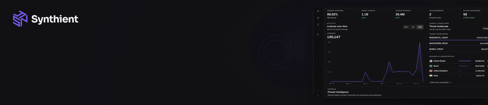

# Anubis

<center>

</center>


[](https://github.com/sponsors/Xe)

## Sponsors

Anubis is brought to you by sponsors and donors like:

### Diamond Tier

<a href="https://www.raptorcs.com/content/base/products.html">
  
</a>
<a href="https://databento.com/?utm_source=anubis&utm_medium=sponsor&utm_campaign=anubis">
  
</a>
<a href="https://spur.us/?utm_source=github&utm_medium=referral&utm_campaign=anubis-readme">
  
</a>

<p>
  <a href="https://synthient.com/?utm_source=anubis">
    
  </a>
</p>

### Gold Tier

<a href="https://www.unipromos.com/?utm_campaign=github&utm_medium=referral&utm_content=anubis">
  
</a>
<a href="https://uvensys.de/?utm_campaign=github&utm_medium=referral&utm_content=anubis">
  
</a>
<a href="https://about.gitea.com?utm_campaign=github&utm_medium=referral&utm_content=anubis">
  
</a>
<a href="https://prolocation.net?utm_campaign=github&utm_medium=referral&utm_content=anubis">
  
</a>
<a href="https://terminaltrove.com/?utm_campaign=github&utm_medium=referral&utm_content=anubis&utm_source=abgh">
  
</a>
<a href="https://canine.tools?utm_campaign=github&utm_medium=referral&utm_content=anubis">
  
</a>
<a href="https://weblate.org/">
  
</a>
<a href="https://uberspace.de/">
  
</a>
<a href="https://wildbase.xyz/">
  
</a>
<a href="https://emma.pet">
  
</a>
<a href="https://felsqualle.com">
  
</a>
<a href="https://www.anexia.com/">
  
</a>
<a href="https://dd-wrt.com/">
  
</a>
<a href="https://www.qwertiko.de?utm_campaign=github&utm_medium=referral&utm_content=anubis">
  
</a>
<a href="https://wenet.pl/?utm_campaign=github&utm_medium=referral&utm_content=anubis">
  
</a>

## Overview

Anubis is a Web AI Firewall Utility that [weighs the soul of your connection](https://en.wikipedia.org/wiki/Weighing_of_souls) using one or more challenges in order to protect upstream resources from scraper bots.

This program is designed to help protect the small internet from the endless storm of requests that flood in from AI companies. Anubis is as lightweight as possible to ensure that everyone can afford to protect the communities closest to them.

Anubis is a bit of a nuclear response. This will result in your website being blocked from smaller scrapers and may inhibit "good bots" like the Internet Archive. You can configure [bot policy definitions](./docs/docs/admin/policies.mdx) to explicitly allowlist them and we are working on a curated set of "known good" bots to allow for a compromise between discoverability and uptime.

In most cases, you should not need this and can probably get by using Cloudflare to protect a given origin. However, for circumstances where you can't or won't use Cloudflare, Anubis is there for you.

If you want to try this out, visit the Anubis documentation site at [anubis.techaro.lol](https://anubis.techaro.lol).

## Support

If you run into any issues running Anubis, please [open an issue](https://github.com/TecharoHQ/anubis/issues/new?template=Blank+issue). Please include all the information I would need to diagnose your issue.

For live chat, please join the [Patreon](https://patreon.com/cadey) and ask in the Patron discord in the channel `#anubis`.

## Star History

<a href="https://www.star-history.com/?type=date&repos=TecharoHQ%2Fanubis">
 <picture>
   <source media="(prefers-color-scheme: dark)" srcset="https://api.star-history.com/chart?repos=TecharoHQ/anubis&type=date&theme=dark&legend=top-left&sealed_token=NijaGjH7lyOz9iUXAO-9vs88h2o0C6cmPKIfKSpvhUrnzP0KtL93_9gsGM0D66Miq8f1b9cynl8o1of6EhFiUQK-uBZqAQqxs6dhM8tcb5Q-YTicObjlrv5RpQUkEu0nVRJ6eoU208uQzm0yNfeOkMcBgvxqPmSVdoUTNB3wjfJodZlPzopX7oVp3aXO" />
   <source media="(prefers-color-scheme: light)" srcset="https://api.star-history.com/chart?repos=TecharoHQ/anubis&type=date&legend=top-left&sealed_token=NijaGjH7lyOz9iUXAO-9vs88h2o0C6cmPKIfKSpvhUrnzP0KtL93_9gsGM0D66Miq8f1b9cynl8o1of6EhFiUQK-uBZqAQqxs6dhM8tcb5Q-YTicObjlrv5RpQUkEu0nVRJ6eoU208uQzm0yNfeOkMcBgvxqPmSVdoUTNB3wjfJodZlPzopX7oVp3aXO" />
   
 </picture>
</a>

## Packaging Status

[](https://repology.org/project/anubis-anti-crawler/versions)

## Contributors

<a href="https://github.com/TecharoHQ/anubis/graphs/contributors">
  
</a>

Made with [contrib.rocks](https://contrib.rocks).

## Fork notes

This repository is a fork with custom extensions (password auth mode, password hints, IP whitelist validation mode, configurable default fallback action). The usage guide below describes this fork; these extensions are not necessarily available in upstream images. See also [docs/FORK.md](./docs/FORK.md) for additional policy examples. Defaults and behavior below are checked against the current source; older examples in that document may differ.

## 使用指南（本 fork）

- [模式选择](#模式选择)
- [最简启动](#最简启动)
- [Docker Compose 模板](#docker-compose-模板)
- [配置来源与优先级](#配置来源与优先级)
- [环境变量速查](#环境变量速查)
- [策略文件模板](#策略文件模板)
- [反向代理与部署注意事项](#反向代理与部署注意事项)

### 模式选择

`AUTH_MODE` 决定“如何认证”，`VALID_MODE` 决定“认证通过后如何记住用户”，两者可以组合：

| `AUTH_MODE` | `VALID_MODE` | 行为                                                   | 适用场景                                     |
| ----------- | ------------ | ------------------------------------------------------ | -------------------------------------------- |
| `pow`       | `jwt`        | 根据策略放行、拒绝或挑战；挑战通过后用 JWT cookie 校验 | 默认组合，面向公开网站的反爬防护             |
| `pow`       | `whitelist`  | 仍根据策略决策；挑战通过后将客户端 IP 加入白名单       | 接受同 IP 共享认证的场景                     |
| `password`  | `jwt`        | 首次访问输入密码，通过后用 JWT cookie 校验             | 共享密码保护站点，通常优先选此组合           |
| `password`  | `whitelist`  | 输入密码后将客户端 IP 加入白名单                       | 固定出口、可信网络且接受同 IP 共享认证的场景 |

注意：

- `pow` 模式不是“所有请求都必须做 PoW”。`ALLOW` 直接放行，`DENY` 直接拒绝，只有 `CHALLENGE` 才进入挑战；具体挑战算法也由策略决定。
- `password` 模式是整站门禁：未认证请求显示密码页，已认证请求不再受 bot 规则中的 `ALLOW` / `DENY` / `CHALLENGE` 限制。不能靠 `ALLOW /healthz` 为站点路径豁免密码认证；策略解析、请求路径校验和 DNSBL 等前置检查仍然存在。
- `whitelist` 按真实客户端 IP 识别用户，不按浏览器区分。公司出口、家庭 NAT、VPN 出口下的其他用户可能共享认证；访问会刷新白名单有效期，IP 变化后需要重新认证。PoW 模式中的 `DENY` 仍优先于白名单。
- 默认存储是内存：重启会清除白名单和密码失败计数，多副本也不自动共享。需要持久化或共享状态时，在策略文件的 `store` 中选择合适的存储后端。
- 密码为共享明文口令的精确匹配，不是用户账号系统，也不支持直接填入密码哈希。简单问答适合低风险访问门槛，不能替代敏感系统的身份认证。

### 最简启动

以下命令假设上游应用已经监听本机 `http://127.0.0.1:3923`。浏览器应访问 Anubis 的 `http://127.0.0.1:8923`，而不是绕过它访问上游。

先从当前源码构建，以确保包含本 fork 的功能：

```sh
npm ci
npm run build
```

需要 Go 1.27.3 或更新版本，以及 Node.js、Rust/wasm32 工具链、esbuild 和资源压缩工具；完整要求见 [贡献指南](./docs/docs/developer/CONTRIBUTING.md)。

**PoW + JWT，本地 HTTP 测试：**

```sh
./var/anubis \
  --target http://127.0.0.1:3923 \
  --bind 127.0.0.1:8923 \
  --metrics-bind 127.0.0.1:9090 \
  --use-remote-address \
  --cookie-secure=false \
  --cookie-partitioned=false \
  --cookie-same-site=Lax
```

这会使用内置 bot 策略，并不保证每个请求都触发挑战。如需所有请求先认证，使用后面的“所有请求都挑战”策略模板。

**密码 + JWT，本地 HTTP 测试：**

```sh
AUTH_MODE=password \
PASSWORD='replace-with-a-strong-password' \
PASSWORD_HINT='请输入管理员提供的访问密码' \
./var/anubis \
  --target http://127.0.0.1:3923 \
  --bind 127.0.0.1:8923 \
  --metrics-bind 127.0.0.1:9090 \
  --use-remote-address \
  --cookie-secure=false \
  --cookie-partitioned=false \
  --cookie-same-site=Lax
```

`PASSWORD_HINT` 显示在密码输入框上方，首次访问就能看到，不需要先输错密码。它可以直接写成问题，例如 `PASSWORD_HINT='二加二等于几？请输入数字'`、`PASSWORD='4'`。提示支持换行，按纯文本转义，不执行 HTML；不设置或留空时不显示。提示公开可见，不要把密码或敏感信息放进去。

如需 IP 白名单，将上面任一示例增加 `VALID_MODE=whitelist` 环境变量，并按需设置 `WHITELIST_TIMEOUT=3600`（秒）。密码、提示和模式也都有对应启动参数，例如 `--auth-mode=password --valid-mode=jwt --password-hint='你的问题'`；密码更适合通过受保护的环境配置传入，避免出现在命令行参数中。

以上禁用 Secure/Partitioned cookie 的设置仅供本地 HTTP 调试。生产应在 HTTPS 后部署，并保持 `COOKIE_SECURE=true`。

### Docker Compose 模板

下面是独立模板，不依赖仓库现有 Compose 文件。在仓库根目录保存为 `compose.yaml`，使用同目录的 `anubis.env` 传入配置；镜像从当前源码构建，不假定已发布镜像包含最新改动。

```yaml
services:
  anubis:
    build:
      context: .
    restart: unless-stopped
    ports:
      - "127.0.0.1:8923:8923"
    extra_hosts:
      - "host.docker.internal:host-gateway"
    env_file:
      - ./anubis.env
```

`anubis.env` 的本地 HTTP 测试模板：

```dotenv
TARGET=http://host.docker.internal:3923
BIND=:8923
METRICS_BIND=:9090
USE_REMOTE_ADDRESS=true

AUTH_MODE=password
VALID_MODE=jwt
PASSWORD='replace-with-a-strong-password'
PASSWORD_HINT='请输入管理员提供的访问密码'
PASSWORD_MAX_FAILS=5
PASSWORD_BAN_TIME=60

COOKIE_SECURE=false
COOKIE_PARTITIONED=false
COOKIE_SAME_SITE=Lax
COOKIE_EXPIRATION_TIME=168h
REDIRECT_DOMAINS=127.0.0.1:8923,localhost:8923
SLOG_LEVEL=INFO
```

启动、查看日志及应用环境变量修改：

```sh
chmod 600 anubis.env
docker compose -f compose.yaml up -d --build
docker compose -f compose.yaml logs -f anubis
# 修改 env 文件后重新创建容器；仅 restart 不会更新容器环境变量
docker compose -f compose.yaml up -d --force-recreate anubis
```

不要提交含真实口令的 env 文件。上游服务必须能被容器访问；Linux 上仅监听宿主机 `127.0.0.1` 的服务通常不能经 host-gateway 访问。上游也在同一 Compose 网络时，直接使用服务名，例如 `TARGET=http://app:3000`，并移除 `extra_hosts`。

切换组合时修改 env 文件：

| 组合             | 必要设置                                                                                |
| ---------------- | --------------------------------------------------------------------------------------- |
| PoW + JWT        | `AUTH_MODE=pow`、`VALID_MODE=jwt`；不需要 `PASSWORD` / `PASSWORD_HINT`                  |
| PoW + IP 白名单  | `AUTH_MODE=pow`、`VALID_MODE=whitelist`、`WHITELIST_TIMEOUT=3600`                       |
| 密码 + JWT       | `AUTH_MODE=password`、`VALID_MODE=jwt`、非空 `PASSWORD`；提示可选                       |
| 密码 + IP 白名单 | `AUTH_MODE=password`、`VALID_MODE=whitelist`、非空 `PASSWORD`、`WHITELIST_TIMEOUT=3600` |

**HTTPS 反代部署时**，在模板中替换这些值，并确保 Anubis 只能被可信代理访问：

```dotenv
USE_REMOTE_ADDRESS=false
COOKIE_SECURE=true
COOKIE_PARTITIONED=false
COOKIE_SAME_SITE=Lax
REDIRECT_DOMAINS=example.com,www.example.com
# 使用 openssl rand -hex 64 生成后替换；所有副本保持一致
HS512_SECRET=replace-with-a-long-random-secret
```

这是同站点反代示例，跨站嵌入或独立认证域名需要另行评估 Cookie Domain、SameSite 和 Partitioned。普通反向代理不必设置 `PUBLIC_URL`；该变量主要用于 forwardAuth 等认证跳转场景。

### 配置来源与优先级

- 同一启动选项的优先级为：**命令行参数 > 进程环境变量 > 当前工作目录自动读取的 `.env` > 内置默认值**。空字符串环境变量不会覆盖默认值；需要显式清空默认值时使用启动参数，例如 `--jwt-restriction-header=`。
- 环境变量名称由参数名称转成大写，并将 `-` / `.` 替换为 `_`：`--password-hint` 对应 `PASSWORD_HINT`，`--cookie-expiration-time` 对应 `COOKIE_EXPIRATION_TIME`。
- Docker Compose 的 `.env` 默认用于 Compose 插值，并不会自动把所有变量注入容器。要传给 Anubis，需要使用 `environment` 或这里的 `env_file`；同时存在时 `environment` 优先于 `env_file`。
- `PASSWORD_BAN_TIME`、`WHITELIST_TIMEOUT` 使用整数秒；`COOKIE_EXPIRATION_TIME` 使用 Go duration，例如 `30m`、`24h`、`168h`，不要写 `7d`。
- `POLICY_FNAME` 指向的 YAML 是 **bot 策略文件**，不是环境变量配置文件。不要把 `AUTH_MODE`、`PASSWORD`、`PASSWORD_HINT` 等直接写进该 YAML 的顶层。
- 环境变量和启动参数在启动时读取，修改后需要重启进程或重新创建容器。完整参数可运行 `./var/anubis --help` 查看。

### 环境变量速查

以下为二进制启动默认值，不是仓库现有 Compose 文件的覆盖值。

**认证与有效期**

| 变量                           | 默认值      | 作用                                                                                |
| ------------------------------ | ----------- | ----------------------------------------------------------------------------------- |
| `AUTH_MODE`                    | `pow`       | `pow` 或 `password`                                                                 |
| `VALID_MODE`                   | `jwt`       | `jwt` 或 `whitelist`                                                                |
| `PASSWORD`                     | 空          | 密码模式必填的共享口令；PoW 模式不使用                                              |
| `PASSWORD_HINT`                | 空          | 密码输入框上方公开显示的提示或问题                                                  |
| `PASSWORD_MAX_FAILS`           | `5`         | 单 IP 累计失败达到此次数后阻止继续尝试                                              |
| `PASSWORD_BAN_TIME`            | `60`        | 失败计数的存储 TTL（秒），每次失败刷新；达到阈值后等 TTL 到期解除，成功认证清除计数 |
| `WHITELIST_TIMEOUT`            | `3600`      | IP 白名单 TTL（秒），访问时滑动续期                                                 |
| `DIFFICULTY`                   | `4`         | 默认挑战难度；策略显式指定的难度不一定使用此值                                      |
| `COOKIE_EXPIRATION_TIME`       | `168h`      | JWT/cookie 有效期；不是 IP 白名单的有效期                                           |
| `JWT_RESTRICTION_HEADER`       | `X-Real-IP` | 将 JWT 绑定到指定请求头的值；默认 IP 变化后需重新认证。该头必须存在且来自可信来源   |
| `DIFFICULTY_IN_JWT`            | `false`     | 将挑战难度写入 JWT，相关校验路径也会检查它                                          |
| `HS512_SECRET`                 | 空          | 固定 HS512 签名密钥，至少 64 字节；未设置时使用 Ed25519                             |
| `ED25519_PRIVATE_KEY_HEX`      | 空          | Ed25519 的 32 字节 seed（64 个十六进制字符），可用 `openssl rand -hex 32` 生成      |
| `ED25519_PRIVATE_KEY_HEX_FILE` | 空          | 从文件读取上述 seed；不要与直接传入的 seed 同时设置                                 |

JWT 模式生产部署应固定签名密钥。没有设置固定密钥时会生成临时 Ed25519 密钥，重启后旧 JWT 失效，多副本也无法自动互认。不要把不同签名方案的密钥配置混用。`PASSWORD_MAX_FAILS` / `PASSWORD_BAN_TIME` / `WHITELIST_TIMEOUT` 应填写正数；非正数会触发代码中的兜底值，并不表示禁用。

**网络、策略与真实 IP**

| 变量                          | 默认值                  | 作用                                                                                                                   |
| ----------------------------- | ----------------------- | ---------------------------------------------------------------------------------------------------------------------- |
| `TARGET`                      | `http://localhost:3923` | 要保护的上游地址；容器里的 localhost 是容器自身                                                                        |
| `BIND`                        | `:8923`                 | HTTP 监听地址                                                                                                          |
| `METRICS_BIND`                | `:9090`                 | 指标及健康检查监听地址；不要直接暴露到公网                                                                             |
| `USE_REMOTE_ADDRESS`          | `false`                 | 用 TCP 对端 IP 覆盖 `X-Real-IP`；直连时使用，可信反代后通常关闭                                                        |
| `CUSTOM_REAL_IP_HEADER`       | 空                      | 将可信代理设置的指定请求头映射为 `X-Real-IP`                                                                           |
| `XFF_STRIP_PRIVATE`           | `true`                  | 构造转发到上游的 `X-Forwarded-For` 时过滤私有地址；不是可信代理访问控制                                                |
| `POLICY_FNAME`                | 空                      | 留空加载内置策略；设置后加载指定策略文件，不会自动叠加内置策略                                                         |
| `DEFAULT_FALLBACK_ACTION`     | 随模式                  | PoW 默认 `ALLOW`，密码默认 `CHALLENGE`；可选 `ALLOW` / `CHALLENGE` / `DENY`，仅在 bot 规则和 thresholds 均未命中时使用 |
| `PUBLIC_URL`                  | 空                      | forwardAuth 等场景中浏览器可访问的 Anubis 地址                                                                         |
| `REDIRECT_DOMAINS`            | 空                      | 允许跳转的主机名列表，逗号分隔；空表示不限制。填写 `example.com` 或 `example.com:8443`，不要带 `https://` 或路径       |
| `TRUST_X_ORIGINAL_URI`        | `false`                 | 是否信任代理传入的 `X-Original-URI` 参与路径判断；仅在可信代理覆盖该头时开启                                           |
| `BASE_PREFIX`                 | 空                      | Anubis 的 URL 路径前缀，例如 `/myapp`                                                                                  |
| `STRIP_BASE_PREFIX`           | `false`                 | 转发到上游时是否移除路径前缀                                                                                           |
| `TARGET_HOST`                 | 空                      | 覆盖发给上游的 Host；默认保留入站 Host                                                                                 |
| `TARGET_SNI`                  | 空                      | 上游 TLS SNI；`auto` 使用请求 Host                                                                                     |
| `TARGET_INSECURE_SKIP_VERIFY` | `false`                 | 跳过上游 TLS 证书校验；生产通常不要开启                                                                                |
| `SLOG_LEVEL`                  | `INFO`                  | 日志级别：`DEBUG` / `INFO` / `WARN` / `ERROR`；策略中的日志配置也可能覆盖它                                            |
| `FORCED_LANGUAGE`             | 空                      | 强制界面语言；空时按请求语言选择，不会自动翻译自定义提示                                                               |

**Cookie 行为**

| 变量                    | 默认值               | 作用                                                                       |
| ----------------------- | -------------------- | -------------------------------------------------------------------------- |
| `COOKIE_PREFIX`         | `techaro.lol-anubis` | Cookie 名前缀，同域多实例可设置不同前缀                                    |
| `DYNAMIC_COOKIE_SUFFIX` | `true`               | 根据 Cookie 设置自动增加名称后缀，实际 Cookie 名不一定等于裸前缀           |
| `COOKIE_SECURE`         | `true`               | 仅通过 HTTPS 发送 Cookie；本地 HTTP 测试才关闭                             |
| `COOKIE_HTTP_ONLY`      | `false`              | 是否禁止页面脚本读取 Cookie；调整前确认当前挑战流程兼容                    |
| `COOKIE_SAME_SITE`      | `None`               | `None` / `Lax` / `Strict` / `Default`；Secure 关闭时 `None` 自动降为 `Lax` |
| `COOKIE_PARTITIONED`    | `true`               | 是否标记分区 Cookie（CHIPS）；本地 HTTP 测试关闭，生产按嵌入场景选择       |
| `COOKIE_DOMAIN`         | 空                   | 固定 Cookie Domain；默认不显式设置域                                       |
| `COOKIE_DYNAMIC_DOMAIN` | `false`              | 按请求 Host 动态推导 Cookie Domain，不能与 `COOKIE_DOMAIN` 同时配置        |

### 策略文件模板

**模板 A：所有请求都挑战。**适合明确需要“先通过挑战再访问”的 PoW 部署；密码模式也可以使用它作为简单策略，但实际显示的仍是密码页。

```yaml
bots:
  - name: challenge-all
    path_regex: .*
    action: CHALLENGE
    challenge:
      algorithm: fast
      difficulty: 4
```

**模板 B：公开健康检查、保护敏感路径、其余使用默认规则。**仅在 PoW 模式下 `ALLOW` 路径才会免挑战；密码模式不会豁免这些路径。

```yaml
bots:
  - name: allow-healthz
    path_regex: ^/healthz$
    action: ALLOW

  - name: challenge-sensitive
    path_regex: ^/(admin|login|signin)(/.*)?$
    action: CHALLENGE
    challenge:
      algorithm: fast
      difficulty: 4

  - import: (data)/meta/default-config.yaml
```

将其中一个模板保存为 `botPolicies.yaml`，在 Compose 服务中增加挂载：

```yaml
volumes:
  - ./botPolicies.yaml:/data/cfg/botPolicies.yaml:ro
```

再在 `anubis.env` 中增加：

```dotenv
POLICY_FNAME=/data/cfg/botPolicies.yaml
```

原生二进制可以使用 `--policy-fname ./botPolicies.yaml`。设置自定义策略后，只有显式 `import` 才会引入内置规则；`(data)` 表示内嵌的规则资源，不需要额外挂载整个源码目录。

规则按顺序执行，第一个命中的 `ALLOW` / `DENY` / `CHALLENGE` 立即决定结果；`WEIGH` 累加权重后继续，之后再检查 `thresholds`，最后才使用 `DEFAULT_FALLBACK_ACTION`。因此，设置 fallback 为 `CHALLENGE` 并不等于覆盖所有已有 `ALLOW`。省略 `thresholds`（包括写成空列表）会补入代码默认阈值；若需要固定“所有请求挑战”，使用模板 A 的显式匹配规则。

### 反向代理与部署注意事项

- **可信 IP 是前提。**直连使用 `USE_REMOTE_ADDRESS=true`；在 Nginx/Caddy/Traefik 后面通常设为 `false`，由代理覆盖 `X-Real-IP`，或用 `CUSTOM_REAL_IP_HEADER` 指定可信头。若在反代后仍读取 TCP 对端，可能把所有用户视为同一个 IP，导致共享白名单、共同触发密码封禁。
- **不要让公网客户端伪造身份头。**只允许可信代理连接 Anubis，并由代理覆盖客户端传入的真实 IP 和转发头；`USE_REMOTE_ADDRESS=false` 本身不会建立可信代理边界。
- **不要开放绕过入口。**上游只能由 Anubis 或受控网络访问；Compose 示例仅将 Anubis 端口绑定到宿主机回环地址，适合同机反代或本机测试。反代也在容器中时应走受控容器网络。
- **保护秘密和状态。**env 文件不是秘密保险箱，有 Docker 管理权限的人仍能读取容器环境。共享 IP 模式不适合需要逐用户隔离的应用；默认内存状态在重启后清空。
- **密码改动不等于注销。**修改 `PASSWORD` 不会自动撤销已签发的有效 JWT 或已有 IP 白名单。紧急撤销需同时考虑 JWT 签名密钥轮换及白名单状态清理；不要把改密码当作全部会话失效机制。
- **forwardAuth 需要完整网关配置。**禁用内置反代可使用 `--target=`；通过环境变量可用 `TARGET=' '`（单个空格，普通空字符串不会覆盖默认值）。还需路由认证页面/API/静态资源、传递可信的 `X-Forwarded-Proto` / `X-Forwarded-Host` / `X-Forwarded-Uri`，并正确处理认证响应；仅设置 `PUBLIC_URL` 并不足以完成集成。参阅 [部署示例](./docs/docs/admin/environments)。
- **本 fork 的参考文件。**[docker-compose.yml](./docker-compose.yml) 使用已发布镜像并挂载 [example.custom.yaml](./example.custom.yaml)；[docker-compose-build.yml](./docker-compose-build.yml) 从源码构建。两者有自己的覆盖值（例如失败次数与封禁时长），不要将示例值误认为二进制默认值。修改代码后应构建新镜像或核实所用镜像确实包含对应功能。
